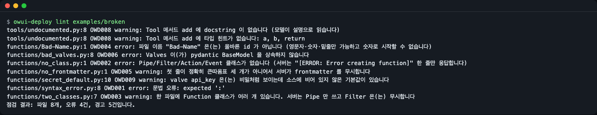
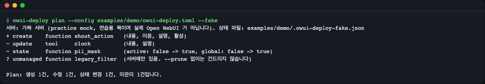
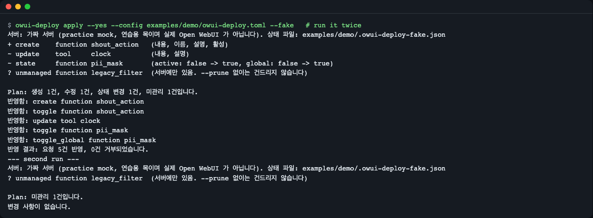
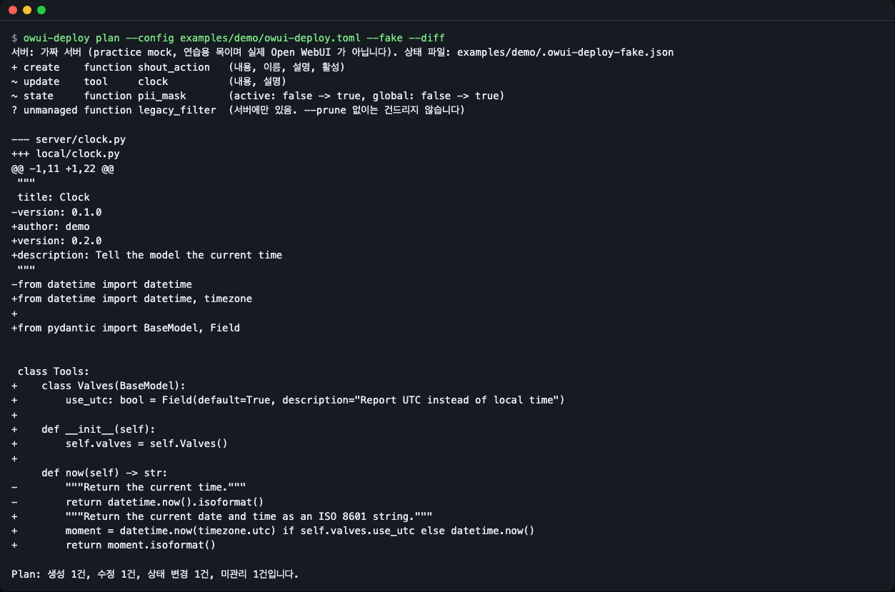
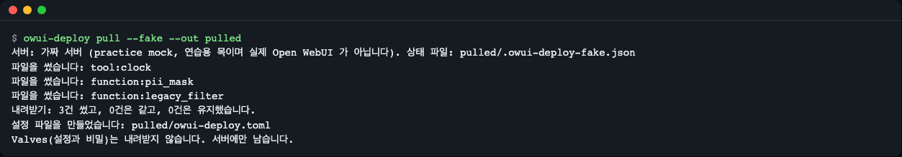
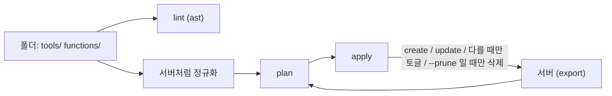

# owui-deploy

[English](README.md) | **한국어**

Open WebUI 의 Tools·Functions(Filter, Pipe, Action)를 git 폴더에 두고, 올리기 전에 점검하고, 서버에서 무엇이 바뀔지 보고, 같은 명령을 몇 번 돌려도 결과가 같게 반영하는 명령줄 도구입니다. `lint`, `plan`, `apply`, `pull` 네 명령으로 이루어져 있고, 내 컴퓨터에서 코드를 실행하지 않습니다.


*`owui-deploy lint` 는 서버가 "Error creating function" 한 줄로만 답하는 문제를 미리 찾아 줍니다. 종료 코드 1 은 문제를 찾았다는 뜻입니다.*

## 이런 분께

- Open WebUI 를 팀이나 집에서 운영하며 관리자 화면에 Tool·Function 코드를 손으로 붙여 넣고 있는 분.
- 풀 리퀘스트에서 서버가 무엇이 바뀔지 보고 싶고, 누가 브라우저에서 Function 을 직접 고쳐 원본과 어긋났는지(드리프트) 확인하고 싶은 분.
- Function 모음을 레포로 관리하며 개발·운영 인스턴스에 같은 버전을 맞추고 싶은 분.

Terraform 을 떠올리면 쉽습니다. 폴더가 원본이고, `plan` 은 차이를 보여 주고, `apply` 는 서버를 폴더에 맞춥니다.

## 설치

Python 3.11 이상이 필요합니다. [uv](https://docs.astral.sh/uv/) 로 설치하면 가장 쉽습니다: `curl -LsSf https://astral.sh/uv/install.sh | sh`. 최소 리눅스 이미지에서는 `git` 도 필요합니다(`apt-get install -y git`).

```bash
uv tool install git+https://github.com/LeeGyeongPil/owui-deploy
owui-deploy --version
```

레포를 clone 해서 써 보려면(아래 예시는 이 방식입니다):

```bash
git clone https://github.com/LeeGyeongPil/owui-deploy
cd owui-deploy
uv run owui-deploy --version
```

## 빠르게 시작하기 (서버 없이)

`--fake` 는 **연습용 목(practice mock)** 입니다. Open WebUI 0.13.3 의 동작을 흉내 내는 작은 내장 서버 모델로, 상태를 설정 파일 옆 JSON 파일에 저장합니다. 진짜 Open WebUI 가 아니고, 여러분의 코드를 실행하지도 않습니다(`ast` 로 클래스 이름만 읽습니다). 명령을 익히는 용도이고, 실제 동작은 진짜 서버에서 확인해야 합니다. 진짜 서버는 준비가 느릴 수 있어서(우리 확인에서 Open WebUI 설치에 약 76초·2GB, 기동에 1분 더) 연습용 목을 둔 것입니다.

```bash
uv run owui-deploy plan --config examples/demo/owui-deploy.toml --fake
```

```
서버: 가짜 서버 (practice mock, 연습용 목이며 실제 Open WebUI 가 아닙니다). 상태 파일: examples/demo/.owui-deploy-fake.json
+ create    function shout_action   (내용, 이름, 설명, 활성)
~ update    tool     clock          (내용, 설명)
~ state     function pii_mask       (active: false -> true, global: false -> true)
? unmanaged function legacy_filter  (서버에만 있음. --prune 없이는 건드리지 않습니다)

Plan: 생성 1건, 수정 1건, 상태 변경 1건, 미관리 1건입니다.
```


*연습용 목은 계획에 보여 줄 것이 있도록 몇 개 항목을 미리 갖고 시작합니다. 차이가 있어서 종료 코드는 1 입니다.*

읽는 법:

| 표시 | 뜻 |
|---|---|
| `+ create` | 폴더에는 있고 서버에는 아직 없습니다. |
| `~ update` | 양쪽에 있지만 코드나 설명이 다릅니다. |
| `~ state` | 켜짐(`active`) 또는 "모든 모델에 적용"(`global`) 스위치가 다릅니다. |
| `? unmanaged` | 서버에만 있습니다. `--prune` 을 주지 않으면 건드리지 않고, 종료 코드를 1 로 만들지도 않습니다. |

이제 두 번 반영해 봅니다.

```bash
uv run owui-deploy apply --yes --config examples/demo/owui-deploy.toml --fake
uv run owui-deploy apply --yes --config examples/demo/owui-deploy.toml --fake
```

```
서버: 가짜 서버 (practice mock, 연습용 목이며 실제 Open WebUI 가 아닙니다). 상태 파일: examples/demo/.owui-deploy-fake.json
+ create    function shout_action   (내용, 이름, 설명, 활성)
~ update    tool     clock          (내용, 설명)
~ state     function pii_mask       (active: false -> true, global: false -> true)
? unmanaged function legacy_filter  (서버에만 있음. --prune 없이는 건드리지 않습니다)

Plan: 생성 1건, 수정 1건, 상태 변경 1건, 미관리 1건입니다.
반영함: create function shout_action
반영함: toggle function shout_action
반영함: update tool clock
반영함: toggle function pii_mask
반영함: toggle_global function pii_mask
반영 결과: 요청 5건 반영, 0건 거부되었습니다.
```

두 번째 실행:

```
서버: 가짜 서버 (practice mock, 연습용 목이며 실제 Open WebUI 가 아닙니다). 상태 파일: examples/demo/.owui-deploy-fake.json
? unmanaged function legacy_filter  (서버에만 있음. --prune 없이는 건드리지 않습니다)

Plan: 미관리 1건입니다.
변경 사항이 없습니다.
```


*두 번째 실행은 쓰기 요청을 보내지 않습니다.*

apply 는 `examples/demo/.owui-deploy-fake.json` 을 만듭니다(git 이 무시합니다). 처음부터 다시 하려면 지웁니다: `rm examples/demo/.owui-deploy-fake.json`.

## 내 Open WebUI 에 연결하기

```bash
export OWUI_URL=http://localhost:8080
export OWUI_TOKEN=<관리자 토큰>
owui-deploy plan
```

- 토큰은 설정 파일에서 읽지 않고 `OWUI_TOKEN` 환경변수로만 받습니다.
- 관리자 **로그인 토큰(JWT)** 을 쓸 수 있습니다. `POST /api/v1/auths/signin`(JSON 본문에 `email`, `password`)으로 로그인하고 응답의 `token` 을 씁니다.
- **API 키**도 쓸 수 있지만, Open WebUI 는 서버를 `ENABLE_API_KEYS=true` 로 띄워야 키를 만들게 해 줍니다. 그렇지 않으면 JWT 를 쓰세요.
- 서버 주소는 설정 파일의 `server.url` 이나 `--url` 로도 줄 수 있습니다(우선순위: `--url`, `OWUI_URL`, 파일).
- `apply` 는 서버가 여러분의 코드를 실행하게 합니다. 실제 서버에 쓰기 전에 [보안 참고](#보안-참고)를 읽어 주세요.

## 명령

| 명령 | 하는 일 | 예 |
|---|---|---|
| `lint [PATH]` | 정적 점검, 코드를 실행하지 않습니다. `--json` 은 기계용, `--strict` 는 경고도 종료 1 로 만듭니다. | `owui-deploy lint examples/broken` |
| `plan` | `apply` 가 바꿀 내용을 보여 줍니다. `--diff` 는 unified diff 추가, `--json` 은 JSON, `--prune` 은 서버에만 있는 항목을 삭제로 표시, `--fail-on-unmanaged` 는 그런 항목이 있으면 종료 1. | `owui-deploy plan --diff` |
| `apply` | 생성·수정하고, 상태가 다를 때만 상태를 바꾸고, `--prune` 일 때만 삭제합니다. 먼저 묻고, `--yes` 면 묻지 않습니다(stdin 이 터미널이 아니면 필수). `--message` 는 서버 이력에 남습니다(기본값: git 짧은 해시). | `owui-deploy apply --yes` |
| `pull --out DIR` | Tools·Functions 를 파일로 내려받고, 없으면 `DIR/owui-deploy.toml` 을 만듭니다. 서버와 다른 로컬 파일은 `--force` 없이는 덮어쓰지 않습니다. | `owui-deploy pull --out ./owui` |

옵션은 명령마다 다릅니다(모든 명령이 `--lang en|ko` 를 받습니다).

| 명령 | 옵션 |
|---|---|
| `plan`, `apply` | `--config PATH`(기본값 `./owui-deploy.toml`), `--url`, `--fake`, `--lang` |
| `pull` | `--out DIR`, `--url`, `--fake`, `--force`, `--lang` (설정 파일은 `DIR/owui-deploy.toml`) |
| `lint` | `[PATH]`, `--config PATH`, `--json`, `--strict`, `--lang` (서버가 필요 없어서 `--url`·`--fake` 는 없습니다) |

종료 코드:

| 코드 | 뜻 |
|---|---|
| 0 | 차이 없음, 문제 없음. |
| 1 | 차이 또는 문제 발견: plan 드리프트, lint 오류, 서버가 항목을 거부함. |
| 2 | 도구 오류: 설정 파일·토큰 없음, 연결 실패, 401/403, 잘못된 사용법. |

### 내용 차이 보기

```bash
uv run owui-deploy plan --config examples/demo/owui-deploy.toml --fake --diff
```


*`--diff` 는 코드 차이를 보여 줍니다. `pii_mask` 의 `from utils.misc` 줄은 차이로 나오지 않습니다. "plan 이 정직한 이유"를 보세요.*

### 기존 서버를 git 으로 옮기기

```bash
uv run owui-deploy pull --fake --out pulled
```

```
서버: 가짜 서버 (practice mock, 연습용 목이며 실제 Open WebUI 가 아닙니다). 상태 파일: pulled/.owui-deploy-fake.json
파일을 썼습니다: tool:clock
파일을 썼습니다: function:pii_mask
파일을 썼습니다: function:legacy_filter
내려받기: 3건 썼고, 0건은 같고, 0건은 유지했습니다.
설정 파일을 만들었습니다: pulled/owui-deploy.toml
Valves(설정과 비밀)는 내려받지 않습니다. 서버에만 남습니다.
```


*Valves(API 키가 들어 있을 수 있는 설정)는 파일에 쓰지 않습니다.*

결과는 `pulled/tools/clock.py`, `pulled/functions/*.py`, `pulled/owui-deploy.toml` 입니다. 정리는 `rm -r pulled`.

## 설정 파일

`owui-deploy.toml` 이고, 경로는 파일 위치 기준입니다. 항목의 id 는 `.py` 를 뺀 파일 이름입니다.

```toml
[server]
url = "http://localhost:8080"   # OWUI_URL 이 덮어쓰고, --url 이 둘 다 덮어씁니다

[paths]
tools = "tools"
functions = "functions"

[defaults]
active = true     # 따로 말하지 않으면 켜서 배포
global = false

[functions.pii_mask]
global = true     # 모든 모델에 적용할 Filter

[functions.shout_action]
name = "Shout"
description = "Add a button that repeats the last answer in capital letters"
```

설정 키는 대소문자를 구분하지 않으며(서버 id 처럼 소문자로 맞춤), 대소문자만 다른 중복 키는 설정 오류입니다.

이름은 설정, 없으면 파일 첫 docstring 의 `title:`, 그것도 없으면 id 입니다. 동작하는 예는 `examples/demo/` 에 있습니다.

| 변수 | 용도 |
|---|---|
| `OWUI_URL` | 서버 주소. |
| `OWUI_TOKEN` | 관리자 JWT 또는 API 키. |
| `OWUI_DEPLOY_LANG` | `en` 또는 `ko`. |

## lint 규칙

서버는 잘못된 업로드에 한 줄(`[ERROR: Error creating function]`)만 답하고 이유는 서버 로그에만 남습니다. `lint` 는 Python `ast` 로 파일을 읽어 이유를 파일·줄·규칙 코드와 함께 알려 줍니다.

| 코드 | 수준 | 찾는 것 |
|---|---|---|
| OWD001 | error | 문법 오류. |
| OWD002 | error | Tool 파일에 `Tools` 클래스가 없거나, Function 파일에 Pipe/Filter/Action/Event 클래스가 없음. |
| OWD003 | warning | 한 파일에 Function 클래스가 여러 개. 서버는 하나(Pipe 우선)만 씁니다. |
| OWD004 | error / warning | 파일 이름이 올바른 id 가 아님(error), 대문자 포함(warning). |
| OWD005 | warning | 첫 줄이 정확히 `"""` 가 아니라 서버가 frontmatter 를 무시함, 또는 `title`/`version` 누락. |
| OWD006 | error | `Valves`·`UserValves` 가 pydantic `BaseModel` 을 상속하지 않음. |
| OWD007 | warning | 서버가 다시 쓰는 `from utils`, `from apps`, `from main`, `from config` import. |
| OWD008 | warning | Tool 공개 메서드에 docstring 이나 타입 힌트가 없음(모델이 도구 설명으로 읽습니다). |
| OWD009 | warning | 비밀처럼 보이는 valve(`api_key`, `token` 등)에 소스에서 비어 있지 않은 기본값. |

## plan 이 정직한 이유



`plan` 은 폴더와 서버를 비교하고, `apply` 는 다른 것만 바꿉니다. 서버에는 함정 네 개가 있고(Open WebUI 0.13.3 에서 확인) 도구가 코드로 피합니다.

1. **import 재작성.** 서버는 저장할 때 `from utils...` 를 `from open_webui.utils...` 로 다시 씁니다. 그래서 단순 비교로는 차이가 0 이 되지 않습니다. `plan` 은 비교 전에 같은 치환을 여러분의 파일에 적용합니다. `lint` 는 OWD007 로 알려 줍니다.
2. **토글 엔드포인트는 반전입니다.** 두 번 부르면 Function 이 다시 꺼집니다. `apply` 는 호출 직전에 현재 상태를 읽고 다를 때만 호출합니다.
3. **새 Function 은 꺼진 채 만들어집니다.** 만든 직후 `apply` 가 선언한 상태로 맞춥니다.
4. **`/functions/sync` 는 말없이 삭제합니다.** 일부 목록으로 sync 하면 나머지가 지워지므로 이 도구는 절대 부르지 않습니다. 삭제는 명시적인 `--prune` 이 필요합니다.

연습용 목은 이 네 동작을 재현하고, 테스트가 실제 0.13.3 서버에서 녹화한 응답(`tests/fixtures/owui-0.13.3/`)과 비교합니다.

## CI 에서 쓰기

```bash
owui-deploy plan --json > plan.json
```

종료 코드 0: 할 일 없음. 1: 서버가 폴더와 다름. 2: 설정 문제(토큰, URL, 설정 파일). 같은 명령을 apply 직후 연습용 목에서 실행한 출력입니다(`서버:` 줄은 다른 스트림으로 나갑니다).

```json
{
  "server": "fake (examples/demo/.owui-deploy-fake.json)",
  "mock": true,
  "changes": [
    {
      "kind": "function",
      "id": "legacy_filter",
      "action": "unmanaged",
      "fields": []
    }
  ],
  "summary": {
    "create": 0,
    "update": 0,
    "state": 0,
    "delete": 0,
    "unmanaged": 1,
    "skipped": 0
  }
}
```

서버에만 있는 항목은 `--fail-on-unmanaged` 를 붙이지 않으면 검사를 실패시키지 않습니다.

## 보안 참고

이 도구는 관리자 토큰을 다루고 서버가 코드를 실행하게 하므로, 한 번은 읽어 주세요.

- **`apply` 는 서버가 여러분의 코드를 실행하게 합니다.** Open WebUI 는 올라온 Tool·Function 코드를 `exec` 로 실행하고, 파일 frontmatter 의 `requirements:` 줄에 적힌 패키지를 `pip install` 로 설치합니다. 직접 검토한 코드만 배포하세요. Open WebUI 는 이를 의도된 동작으로 봅니다. [CVE-2026-0765 벤더 처분](https://docs.openwebui.com/security/vendor-dispositions/cve-2026-0765)을 보세요(2026-11-12 확인).
- **valves 값은 파일에 쓰지 않습니다.** `pull` 은 valves 를 요청하지 않고, 서버가 보내도 버립니다. 관리자 화면에서 넣은 API 키가 git 에 들어가지 않습니다. `lint` 규칙 OWD009 는 소스에 비밀처럼 보이는 기본값이 있으면 경고합니다.
- **토큰은 `OWUI_TOKEN` 으로만 받습니다.** 설정 파일에서 읽지 않고, 출력하지도 않습니다.
- **토큰은 서버 URL 로 전송됩니다.** URL 은 설정 파일의 `server.url` 에서 올 수 있으므로, CI 에서는 `OWUI_URL` 을 시크릿이나 보호된 변수로 고정하세요. 그러면 풀 리퀘스트가 파일의 URL 을 바꿔 토큰을 다른 곳으로 보낼 수 없습니다. 서버가 내 컴퓨터가 아니면 `https://` 를 쓰세요.
- `lint` 와 `--fake` 는 여러분의 코드를 실행하지 않고 `ast` 로 읽기만 합니다.

## 화면 언어

출력과 `--help` 는 영어와 한국어를 지원합니다. 우선순위는 `--lang en|ko`, `OWUI_DEPLOY_LANG`, `LC_ALL`, `LC_MESSAGES`, `LANG` 순이고, 한국어가 아니면 영어입니다.

```bash
uv run owui-deploy --lang ko plan --config examples/demo/owui-deploy.toml --fake
```

이 문서의 스크린샷은 모두 한국어 출력입니다. 영어 화면은 [README.md](README.md) 를 보세요.

## 언제 쓰나

- 이럴 때: 직접 만든 Tools·Functions 를 git 에 두고 lint, 리뷰할 수 있는 plan, 반복해도 같은 apply 를 원할 때.
- 다른 일에는 다른 도구: 아래 [다른 도구와 비교](#다른-도구와-비교) 를 보세요.
- 0.1.2 에서 다루지 않는 것: valves 값, 한 설정의 여러 환경, 이력·롤백, Models·Prompts·Knowledge.

## 다른 도구와 비교

한 줄로 말하면: owui-cli 는 **명령형** 도구입니다(파일마다 명령을 하나씩 실행하고, 서버가 바로 바뀝니다). owui-deploy 는 **선언형**입니다(폴더와 `owui-deploy.toml` 이 원하는 상태를 적고, `plan` 이 차이를 보여 주고, `apply` 가 그 차이를 메웁니다). 그리고 올리기 전에 `lint` 로 검사합니다.

| 도구(2026-11-12 확인 버전) | 무엇인가 | 파일에서 Tools·Functions 배포 | 바꾸기 전 미리 보기(plan/diff, 차이 있을 때 종료 코드) | 올리기 전 정적 검사 | `active`·`global` 상태 선언 |
|---|---|---|---|---|---|
| [oikb](https://docs.openwebui.com/ecosystem/knowledge-base-sync) 0.6.0 (공식) | 로컬 폴더·GitHub·Confluence 등의 파일을 **지식 베이스**로 동기화, `--dry-run` 지원 | 대상 아님 | 지식 베이스에 한해(`--dry-run`) | 없음 | 없음 |
| [owui-cli](https://github.com/rndmcnlly/owui-cli) 0.7.1 | Open WebUI 여러 리소스용 명령형 CLI: `tools deploy file.py`(없으면 생성, 있으면 수정), `pull-all`, `valves-set` | 있음, 명령 하나에 파일 하나(owui-deploy 와 겹치는 부분) | 없음 | 없음 | 없음 |
| [owui-client](https://pypi.org/project/owui-client/) 11.0.0 | 직접 만드는 스크립트용, 전체 API 비동기 Python 클라이언트 | 직접 짠 코드로(`create`·`update`, `sync_functions`) | 없음 | 없음 | 직접 짠 코드로 |
| [suurt8ll/open_webui_functions](https://github.com/suurt8ll/open_webui_functions) `dev/function_updater.py` | 한 레포 전용 개발 스크립트: `FILEPATHS` 에 적은 파일을 올리고 변경을 감시 | 있음, 그 레포에 한해 | 없음 | 없음 | 없음 |
| owui-deploy 0.1.2 (이 레포) | 선언형 `lint`·`plan`·`apply`·`pull` | 있음, 폴더 전체 | 있음(`plan`, `--diff`, `--json`, 차이가 있으면 종료 1) | 있음(`lint`, OWD001~OWD009) | 있음 |

참고:

- owui-cli 도 Tool 파일을 배포하고 `pull-all` 로 전부 내보낼 수 있습니다. 가끔 파일 하나만 올리면 된다면 그것으로 충분합니다. owui-deploy 는 git 의 폴더를 원본으로 삼고, 서버를 바꾸기 전에 CI 에서 plan 을 리뷰하고 싶을 때 씁니다.
- owui-deploy 는 비교 전에 서버의 import 재작성을 똑같이 적용하고(가짜 차이 없음), 상태가 다를 때만 토글을 부르며, `/functions/sync` 를 부르지 않습니다. 이 엔드포인트는 받은 목록에 없는 Function 을 모두 지웁니다. owui-client 의 `sync_functions` 를 쓴다면 전체 목록을 보내야 합니다.
- owui-deploy 는 지식 베이스를 다루지 않습니다. 그 일은 oikb 를 쓰세요.

출처(2026-11-12 확인): [oikb 문서](https://docs.openwebui.com/ecosystem/knowledge-base-sync), [oikb PyPI](https://pypi.org/project/oikb/), [owui-cli GitHub](https://github.com/rndmcnlly/owui-cli), [owui-cli PyPI](https://pypi.org/project/owui-cli/), [owui-client 레퍼런스](https://whogben.github.io/owui_client/reference/routers/functions), [owui-client PyPI](https://pypi.org/project/owui-client/), [suurt8ll/open_webui_functions](https://github.com/suurt8ll/open_webui_functions). 확인 날짜 이후 바뀌었을 수 있습니다.

## 자주 겪는 문제

| 증상 | 원인 | 해결 |
|---|---|---|
| `error: no token. Export OWUI_TOKEN ...` (종료 2) | `OWUI_TOKEN` 이 없습니다. | 관리자 JWT 나 API 키를 export 하거나 `--fake` 를 붙입니다. |
| `error: cannot connect to ...` (종료 2) | 서버가 꺼져 있거나 URL 이 틀렸습니다. | URL 과 Open WebUI 실행 여부를 확인합니다. |
| `the server refused the token (HTTP 401/403 ...)` (종료 2) | 토큰 만료, 관리자 아님, API 키 비활성. | 새 관리자 JWT 를 쓰거나 서버를 `ENABLE_API_KEYS=true` 로 띄웁니다. |
| `error: config file not found: ...` (종료 2) | 현재 폴더에 `owui-deploy.toml` 이 없습니다. | `--config PATH` 를 주거나 `pull --out` 으로 만듭니다. |
| 서버가 항목을 거부함, 종료 1 | 서버가 설명해 주지 않는 lint 오류인 경우가 많습니다. | `owui-deploy lint` 를 돌려 나온 줄을 고칩니다. |
| `plan` 에 `? unmanaged` 가 보임 | 항목이 서버에만 있습니다. | `pull` 로 파일을 가져오거나 `apply --prune` 으로 지웁니다. |

(오류 메시지는 영어 출력 기준으로 적었습니다. `--lang ko` 에서는 한국어로 나옵니다.)

## 개발

```bash
uv run pytest -q
```

버그와 제안은 이슈로 남겨 주세요. 변경 기록은 [CHANGELOG.md](CHANGELOG.md).

## 확인한 환경

| 대상 | 버전 | 방법 |
|---|---|---|
| Open WebUI | 0.13.3 | 실제 서버에 대한 1회 실행(`tests/test_e2e_real.py`, `OWUI_E2E_URL`·`OWUI_E2E_TOKEN` 필요). |
| 연습용 목(`--fake`) | 0.13.3 을 따름 | 0.13.3 에서 녹화한 응답과 계약 테스트로 맞춤. |
| Python | 3.11, 3.13 (CI) | `uv run pytest -q`. |

## 라이선스

MIT, [LICENSE](LICENSE) 참고. Open WebUI 는 별도 라이선스이고, 이 프로젝트는 Open WebUI 와 관련이 없습니다.
