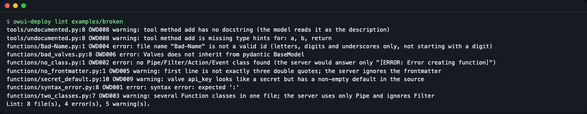
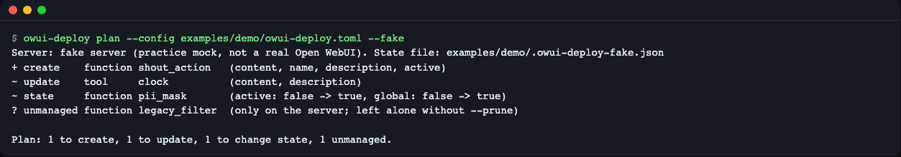
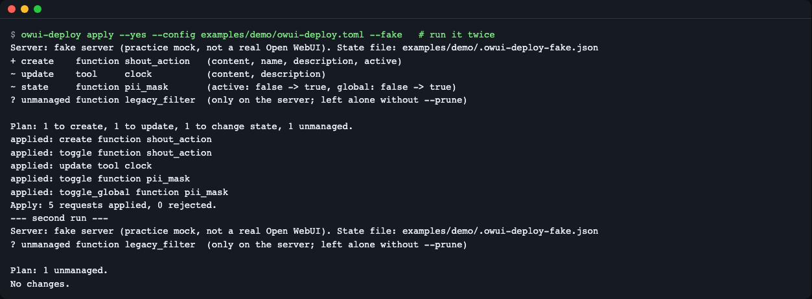
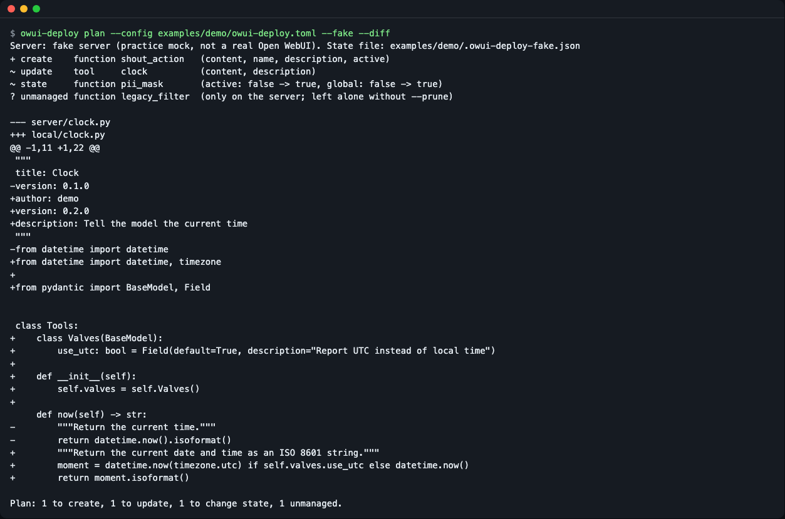
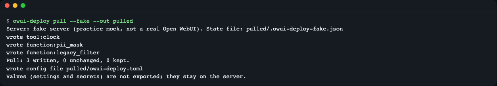
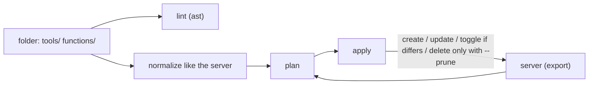

# owui-deploy

**English** | [한국어](README.ko.md)

Keep your Open WebUI Tools and Functions (Filter, Pipe, Action) in a git folder, check them before upload, see what would change on the server, and apply the changes so that running the same command twice gives the same result. A `lint`, `plan`, `apply` and `pull` command line tool, with no code execution on your machine.


*`owui-deploy lint` finds problems that the server would only report as "Error creating function". Exit code 1 means problems were found.*

## Who it is for

- You run Open WebUI for a team or at home and paste Tool and Function code into the admin screen by hand.
- You want a pull request to show what will change on the server, and a check that nobody edited a Function in the browser (drift).
- You keep a collection of Functions in a repository and want the same version on a dev and a prod instance.

Think of Terraform: the folder is the source of truth, `plan` shows the difference, `apply` makes the server match.

## Install

Needs Python 3.11 or newer. [uv](https://docs.astral.sh/uv/) is the easiest way to get it: `curl -LsSf https://astral.sh/uv/install.sh | sh`. On a minimal Linux image you also need `git` (`apt-get install -y git`).

```bash
uv tool install git+https://github.com/LeeGyeongPil/owui-deploy
owui-deploy --version
```

To try it from a clone instead (this is what the examples below use):

```bash
git clone https://github.com/LeeGyeongPil/owui-deploy
cd owui-deploy
uv run owui-deploy --version
```

## Quick start (no server needed)

`--fake` switches to a **practice mock**: a small built-in model of Open WebUI 0.13.3 that keeps its state in a JSON file next to your config. It is not a real Open WebUI, and it never runs your code (it only reads the class names with `ast`). Use it to learn the commands. Use a real server to verify real behavior. A real server can be slow to start (installing Open WebUI took about 76 seconds and 2 GB in our probe, and start-up another minute), which is why the practice mock exists.

```bash
uv run owui-deploy plan --config examples/demo/owui-deploy.toml --fake
```

```
Server: fake server (practice mock, not a real Open WebUI). State file: examples/demo/.owui-deploy-fake.json
+ create    function shout_action   (content, name, description, active)
~ update    tool     clock          (content, description)
~ state     function pii_mask       (active: false -> true, global: false -> true)
? unmanaged function legacy_filter  (only on the server; left alone without --prune)

Plan: 1 to create, 1 to update, 1 to change state, 1 unmanaged.
```


*The practice mock starts with a few items so the plan has something to show. The exit code is 1 because there are differences.*

How to read it:

| Mark | Meaning |
|---|---|
| `+ create` | In your folder, not on the server yet. |
| `~ update` | On both, but the code or description differs. |
| `~ state` | The on/off (`active`) or "for all models" (`global`) switch differs. |
| `? unmanaged` | Only on the server. Left alone unless you pass `--prune`. It does not make the exit code 1. |

Now apply it, twice:

```bash
uv run owui-deploy apply --yes --config examples/demo/owui-deploy.toml --fake
uv run owui-deploy apply --yes --config examples/demo/owui-deploy.toml --fake
```

```
Server: fake server (practice mock, not a real Open WebUI). State file: examples/demo/.owui-deploy-fake.json
+ create    function shout_action   (content, name, description, active)
~ update    tool     clock          (content, description)
~ state     function pii_mask       (active: false -> true, global: false -> true)
? unmanaged function legacy_filter  (only on the server; left alone without --prune)

Plan: 1 to create, 1 to update, 1 to change state, 1 unmanaged.
applied: create function shout_action
applied: toggle function shout_action
applied: update tool clock
applied: toggle function pii_mask
applied: toggle_global function pii_mask
Apply: 5 requests applied, 0 rejected.
```

Second run:

```
Server: fake server (practice mock, not a real Open WebUI). State file: examples/demo/.owui-deploy-fake.json
? unmanaged function legacy_filter  (only on the server; left alone without --prune)

Plan: 1 unmanaged.
No changes.
```


*The second run sends no write requests.*

Apply created `examples/demo/.owui-deploy-fake.json` (ignored by git). Delete it to start over: `rm examples/demo/.owui-deploy-fake.json`.

## Connect to your Open WebUI

```bash
export OWUI_URL=http://localhost:8080
export OWUI_TOKEN=<admin token>
owui-deploy plan
```

- The token is never read from the config file, only from `OWUI_TOKEN`.
- An admin **login token (JWT)** works: sign in with `POST /api/v1/auths/signin` (JSON body with `email` and `password`) and take `token` from the answer.
- An **API key** also works, but Open WebUI only lets you create one when the server runs with `ENABLE_API_KEYS=true`. Without that, use the JWT.
- The server URL can also come from `server.url` in the config file or `--url` (priority: `--url`, then `OWUI_URL`, then the file).
- `apply` makes the server run your code. Read [Security notes](#security-notes) before you point it at a real server.

## Commands

| Command | What it does | Example |
|---|---|---|
| `lint [PATH]` | Static checks, no code is executed. `--json` for machines, `--strict` makes warnings exit 1. | `owui-deploy lint examples/broken` |
| `plan` | Shows what `apply` would change. `--diff` adds a unified diff, `--json` prints JSON, `--prune` shows server-only items as deletions, `--fail-on-unmanaged` exits 1 for them. | `owui-deploy plan --diff` |
| `apply` | Creates and updates, switches state only when it differs, deletes only with `--prune`. Asks first; `--yes` skips the question (required when stdin is not a terminal). `--message` is stored in the server history (default: the git short hash). | `owui-deploy apply --yes` |
| `pull --out DIR` | Downloads Tools and Functions into files and creates `DIR/owui-deploy.toml` if missing. Does not overwrite files that differ from the server unless `--force`. | `owui-deploy pull --out ./owui` |

Options differ per command (all of them take `--lang en|ko`):

| Command | Options |
|---|---|
| `plan`, `apply` | `--config PATH` (default `./owui-deploy.toml`), `--url`, `--fake`, `--lang` |
| `pull` | `--out DIR`, `--url`, `--fake`, `--force`, `--lang` (the config file is `DIR/owui-deploy.toml`) |
| `lint` | `[PATH]`, `--config PATH`, `--json`, `--strict`, `--lang` (needs no server, so no `--url` or `--fake`) |

Exit codes:

| Code | Meaning |
|---|---|
| 0 | No difference, no problem. |
| 1 | A difference or problem was found: plan drift, lint error, or the server rejected an item. |
| 2 | Tool error: missing config or token, cannot connect, 401/403, wrong usage. |

### See the content difference

```bash
uv run owui-deploy plan --config examples/demo/owui-deploy.toml --fake --diff
```


*`--diff` shows the code difference. The `from utils.misc` line in `pii_mask` is not listed as a difference, see "How plan stays honest".*

### Pull an existing server into git

```bash
uv run owui-deploy pull --fake --out pulled
```

```
Server: fake server (practice mock, not a real Open WebUI). State file: pulled/.owui-deploy-fake.json
wrote tool:clock
wrote function:pii_mask
wrote function:legacy_filter
Pull: 3 written, 0 unchanged, 0 kept.
wrote config file pulled/owui-deploy.toml
Valves (settings and secrets) are not exported; they stay on the server.
```


*Valves (settings that can hold API keys) are never written to files.*

The result is `pulled/tools/clock.py`, `pulled/functions/*.py` and `pulled/owui-deploy.toml`. Clean up with `rm -r pulled`.

## Config file

`owui-deploy.toml`, paths are relative to the file. The id of an item is its file name without `.py`.

```toml
[server]
url = "http://localhost:8080"   # OWUI_URL overrides it, --url overrides both

[paths]
tools = "tools"
functions = "functions"

[defaults]
active = true     # deploy everything switched on unless said otherwise
global = false

[functions.pii_mask]
global = true     # a Filter that should run for every model

[functions.shout_action]
name = "Shout"
description = "Add a button that repeats the last answer in capital letters"
```

Config keys are case-insensitive (matched in lowercase, like server ids), and two keys that differ only in case are a config error.

The name comes from the config, else the `title:` in the file's first docstring, else the id. A working copy is in `examples/demo/`.

| Variable | Use |
|---|---|
| `OWUI_URL` | Server address. |
| `OWUI_TOKEN` | Admin JWT or API key. |
| `OWUI_DEPLOY_LANG` | `en` or `ko`. |

## Lint rules

The server answers a broken upload with one line (`[ERROR: Error creating function]`) and the reason only appears in its log. `lint` reads the files with Python's `ast` and reports the reason, with file, line and rule code.

| Code | Level | What it finds |
|---|---|---|
| OWD001 | error | Syntax error. |
| OWD002 | error | No `Tools` class in a tool file, or no Pipe/Filter/Action/Event class in a function file. |
| OWD003 | warning | Several Function classes in one file. The server uses one (Pipe first). |
| OWD004 | error / warning | File name is not a valid id (error), or contains capitals (warning). |
| OWD005 | warning | First line is not exactly `"""`, so the server ignores the frontmatter; or `title`/`version` missing. |
| OWD006 | error | `Valves` or `UserValves` does not inherit from pydantic `BaseModel`. |
| OWD007 | warning | `from utils`, `from apps`, `from main` or `from config` imports, which the server rewrites. |
| OWD008 | warning | Public Tool method without docstring or type hints (the model reads them as the tool description). |
| OWD009 | warning | A secret-looking valve (`api_key`, `token`, ...) with a non-empty default in the source. |

## How plan stays honest



`plan` compares your files with the server, `apply` changes only what differs. The server has four traps that the tool handles in code (observed on Open WebUI 0.13.3):

1. **Import rewriting.** The server rewrites `from utils...` to `from open_webui.utils...` when saving, so a naive diff never reaches zero. `plan` applies the same rewrite to your file before comparing. `lint` warns with OWD007.
2. **The toggle endpoint flips.** Calling it twice turns the Function off again. `apply` reads the current state right before and calls it only when the state differs.
3. **New Functions start inactive.** After creating, `apply` switches them to the state you declared.
4. **`/functions/sync` deletes silently.** Syncing a partial list deletes everything else, so this tool never calls it. Deleting needs the explicit `--prune`.

The practice mock reproduces these four behaviors, and the tests compare it with responses recorded from a real 0.13.3 server (`tests/fixtures/owui-0.13.3/`).

## Use in CI

```bash
owui-deploy plan --json > plan.json
```

Exit code 0: nothing to do. 1: the server differs from the folder. 2: setup problem (token, URL, config). Output of the same command on the practice mock after an apply (the `Server:` line goes to the other stream):

```json
{
  "server": "fake (examples/demo/.owui-deploy-fake.json)",
  "mock": true,
  "changes": [
    {
      "kind": "function",
      "id": "legacy_filter",
      "action": "unmanaged",
      "fields": []
    }
  ],
  "summary": {
    "create": 0,
    "update": 0,
    "state": 0,
    "delete": 0,
    "unmanaged": 1,
    "skipped": 0
  }
}
```

Server-only items do not fail the check unless you add `--fail-on-unmanaged`.

## Security notes

This tool holds an admin token and makes a server run code, so read this once.

- **`apply` makes the server execute your code.** Open WebUI runs uploaded Tool and Function code with `exec`, and installs the packages listed in the `requirements:` line of the file's frontmatter with `pip install`. Deploy only code you have reviewed. Open WebUI treats this as intended behavior, see its [vendor disposition for CVE-2026-0765](https://docs.openwebui.com/security/vendor-dispositions/cve-2026-0765) (checked 2026-11-12).
- **Valves values never touch your files.** `pull` does not request valves and drops them if a server sends them, so API keys set in the admin screen do not end up in git. `lint` rule OWD009 warns about secret-looking defaults in the source.
- **The token comes only from `OWUI_TOKEN`.** It is never read from the config file and never printed.
- **The token is sent to the server URL.** The URL can come from `server.url` in the config file, so in CI pin `OWUI_URL` as a secret or protected variable. Then a pull request cannot change the URL in the file to send your token elsewhere. Use `https://` when the server is not on your own machine.
- `lint` and `--fake` never run your code; they only parse it with `ast`.

## Language

Output and `--help` are available in English and Korean. Priority: `--lang en|ko`, then `OWUI_DEPLOY_LANG`, then `LC_ALL`, `LC_MESSAGES`, `LANG`. Anything that is not Korean falls back to English.

```bash
uv run owui-deploy --lang ko plan --config examples/demo/owui-deploy.toml --fake
```

See [README.ko.md](README.ko.md) for the Korean screenshots.

## When to use it

- Good fit: your own Tools and Functions live in git and you want lint, a reviewable plan and a repeatable apply.
- Different tools for other jobs: see [Compared with other tools](#compared-with-other-tools) below.
- Not covered in 0.1.2: valves values, several environments in one config, history and rollback, Models, Prompts and Knowledge.

## Compared with other tools

The short version: owui-cli is an **imperative** tool (you run one command per file, it changes the server right away). owui-deploy is **declarative** (the folder and `owui-deploy.toml` describe the wanted state, `plan` shows the difference, `apply` closes it) and adds `lint` before anything is uploaded.

| Tool (version checked 2026-11-12) | What it is | Tools and Functions from files | Preview before change (plan/diff, drift exit code) | Static checks before upload | Declared `active` / `global` state |
|---|---|---|---|---|---|
| [oikb](https://docs.openwebui.com/ecosystem/knowledge-base-sync) 0.6.0 (official) | Syncs files from local folders, GitHub, Confluence and more into **knowledge bases**, with `--dry-run` | Not its job | For knowledge bases (`--dry-run`) | No | No |
| [owui-cli](https://github.com/rndmcnlly/owui-cli) 0.7.1 | Imperative CLI for many Open WebUI resources: `tools deploy file.py` (create or update), `pull-all`, `valves-set` | Yes, one file per command (this overlaps with owui-deploy) | No | No | No |
| [owui-client](https://pypi.org/project/owui-client/) 11.0.0 | Async Python client for the whole API, for your own scripts | Through your own code (`create`/`update`, `sync_functions`) | No | No | Through your own code |
| [suurt8ll/open_webui_functions](https://github.com/suurt8ll/open_webui_functions) `dev/function_updater.py` | Development script inside one repository: uploads the files listed in `FILEPATHS`, watches for changes | Yes, for that repository | No | No | No |
| owui-deploy 0.1.2 (this repo) | Declarative `lint` / `plan` / `apply` / `pull` | Yes, a whole folder | Yes (`plan`, `--diff`, `--json`, exit code 1 on drift) | Yes (`lint`, OWD001-OWD009) | Yes |

Notes:

- owui-cli can also deploy a Tool file and export everything with `pull-all`. If you only need to push one file now and then, it does the job. owui-deploy is for when the folder in git is the source of truth and you want to review a plan in CI before changing the server.
- owui-deploy also matches the server's import rewriting before comparing (no false diffs), flips the toggle only when the state differs, and never calls `/functions/sync`, which deletes every Function missing from the list it receives. If you use owui-client's `sync_functions`, send the full list.
- owui-deploy does not manage knowledge bases; use oikb for that.

Sources, checked 2026-11-12: [oikb docs](https://docs.openwebui.com/ecosystem/knowledge-base-sync), [oikb on PyPI](https://pypi.org/project/oikb/), [owui-cli on GitHub](https://github.com/rndmcnlly/owui-cli), [owui-cli on PyPI](https://pypi.org/project/owui-cli/), [owui-client reference](https://whogben.github.io/owui_client/reference/routers/functions), [owui-client on PyPI](https://pypi.org/project/owui-client/), [suurt8ll/open_webui_functions](https://github.com/suurt8ll/open_webui_functions). These tools may have changed since that date.

## Troubleshooting

| Symptom | Cause | Fix |
|---|---|---|
| `error: no token. Export OWUI_TOKEN ...` (exit 2) | `OWUI_TOKEN` is not set. | Export an admin JWT or API key, or add `--fake`. |
| `error: cannot connect to ...` (exit 2) | Server is down or the URL is wrong. | Check the URL and that Open WebUI is running. |
| `the server refused the token (HTTP 401/403 ...)` (exit 2) | Token expired, not admin, or API keys disabled. | Use a fresh admin JWT, or start the server with `ENABLE_API_KEYS=true`. |
| `error: config file not found: ...` (exit 2) | No `owui-deploy.toml` in the current folder. | Pass `--config PATH` or run `pull --out` to create one. |
| The server rejected an item, exit 1 | Usually a lint error the server will not explain. | Run `owui-deploy lint` and fix the lines it lists. |
| `plan` shows `? unmanaged` | The item exists only on the server. | Add the file with `pull`, or delete it with `apply --prune`. |

## Development

```bash
uv run pytest -q
```

Bugs and ideas are welcome as issues. Changes are listed in [CHANGELOG.md](CHANGELOG.md).

## Tested with

| What | Version | How |
|---|---|---|
| Open WebUI | 0.13.3 | One run against a real server (`tests/test_e2e_real.py`, needs `OWUI_E2E_URL` and `OWUI_E2E_TOKEN`). |
| Practice mock (`--fake`) | follows 0.13.3 | Matched to responses recorded from 0.13.3 by contract tests. |
| Python | 3.11 and 3.13 (CI) | `uv run pytest -q`. |

## License

MIT, see [LICENSE](LICENSE). Open WebUI has its own license; this project is not affiliated with it.
